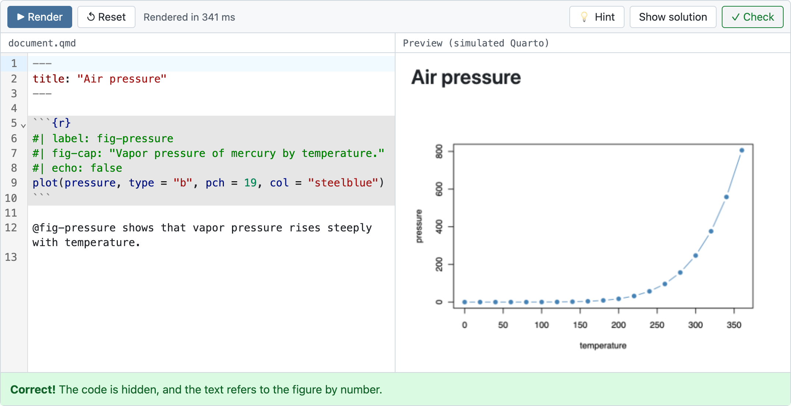

# quarto-simulator

[](https://github.com/ryjohnson09/quarto-simulator/actions/workflows/test.yml)
[](https://ryjohnson09.github.io/quarto-simulator/)

**[Try it on the website →](https://ryjohnson09.github.io/quarto-simulator/)**

A Quarto extension for **teaching the basics of Quarto and markdown inside a
Quarto lesson**. It turns a block in the lesson into an editor and a live
preview that *simulate* `quarto render`, with optional graded exercises.
Learners write YAML, markdown, and R or Python code cells, and see the result
the way Quarto would render it.

Everything runs in the learner's browser. Nothing is installed and nothing is
sent to a server, so lessons stay static HTML.



`````markdown
````{quarto-simulator}
#| exercise: ex-cells
---
title: "Air pressure"
---

```{r}
plot(pressure, type = "b")
```
````
`````

**It is a simulation, not Quarto.** The markdown-to-HTML step is real:
Quarto 1.10's own reader, Lua filters and template run in a WebAssembly
build of pandoc, so callouts, cross-references, figures and tables of
contents look as they do in Quarto. The rest is reimplemented for the
browser: reading the YAML, running R (with [webR](https://docs.r-wasm.org/webr/))
and Python (with IPython in [Pyodide](https://pyodide.org)), and part of
Quarto's HTML post-processing. Only HTML output is supported.

## Install

```bash
quarto add ryjohnson09/quarto-simulator
```

Then add the filter to a lesson, and set `engine: markdown` so that knitr or
Jupyter doesn't run the code cells inside the playgrounds when the lesson
itself renders:

```yaml
---
title: "My lesson"
engine: markdown
filters:
  - quarto-simulator
---
```

Lessons can be rendered with Quarto 1.9 or later, and must be served over
HTTP (`quarto preview`, GitHub Pages, any web server).

## Documentation

The [website](https://ryjohnson09.github.io/quarto-simulator/) is built with
the extension, so every example is live:

| Vignette | Covers |
|---|---|
| [Get started](https://ryjohnson09.github.io/quarto-simulator/vignettes/get-started.html) | Installing, writing a playground, and its options |
| [Exercises](https://ryjohnson09.github.io/quarto-simulator/vignettes/exercises.html) | Hints, solutions, and checks that grade the learner's document |
| [R code](https://ryjohnson09.github.io/quarto-simulator/vignettes/r-code.html) | R cells in webR: options, figures, packages, and how they differ from knitr |
| [Python code](https://ryjohnson09.github.io/quarto-simulator/vignettes/python-code.html) | Python cells in Pyodide: packages, plots, tables, inline code, stopping long-running code |
| [Example lesson](https://ryjohnson09.github.io/quarto-simulator/vignettes/example-lesson.html) | A complete lesson with four graded exercises |
| [How it works](https://ryjohnson09.github.io/quarto-simulator/vignettes/how-it-works.html) | What is real Quarto and what is simulated, performance, hosting and embedding |

## Writing a playground

A `quarto-simulator` block holds the learner's starting document. Use a fence
with more backticks than any fence inside it. Options go in `#|` lines at the
top:

| Option       | Default        | Meaning                                                    |
|--------------|----------------|------------------------------------------------------------|
| `exercise`   | none           | ID that links the playground to checks, hints and solutions |
| `file`       | none           | Load the starting document from a file, relative to the lesson |
| `height`     | `460`          | Height of the editor and of the preview, in pixels         |
| `layout`     | `vertical`     | `horizontal` puts the preview beside the editor            |
| `column`     | body           | A Quarto column, such as `page-inset-right`                |
| `autorender` | `true`         | Render when the playground first scrolls into view         |
| `live`       | `false`        | Re-render as the learner types                             |
| `filename`   | `document.qmd` | Name shown above the editor                                |

## Writing an exercise

Hints, a solution and a check attach to a playground by its `exercise` ID:

`````markdown
::: {.hint exercise="ex-cells"}
`#| echo: false` hides a cell's code.
:::

::: {.solution exercise="ex-cells"}
````markdown
---
title: "Air pressure"
---

```{r}
#| echo: false
plot(pressure, type = "b")
```
````
:::

```{quarto-simulator-check}
#| exercise: ex-cells
const cell = result.cells.find(c => c.lang === "r")
if (cell.options.echo !== false) return fail("The code is still showing. Which cell option hides it?")
return pass("The code is hidden.")
```
`````

A check is the body of an async JavaScript function that returns
`pass(message)` or `fail(message)`. It receives `result`, with the learner's
`source`, the parsed `yaml`, the rendered page as `html` (a `Document`) and
`text`, each code cell's options and outputs in `cells`, and render
`warnings`. See [Exercises](https://ryjohnson09.github.io/quarto-simulator/vignettes/exercises.html).

## What it does not do

- **Formats other than HTML.** A `format: pdf` document previews as HTML,
  with a notice.
- **Themes, projects and files.** `theme`, multi-file projects, local images
  and data files, bibliographies, and third-party Quarto extensions.
- **Julia and OJS.**
- **Some of Quarto's HTML post-processing.** Margin columns, code annotation
  markup and the footnotes appendix render, but not exactly as Quarto lays
  them out.
- **Interrupting R.** An infinite loop in R needs a page reload. Python has a
  **Stop** button.

## Notes for platform and LMS embedding

- **Downloads.** pandoc (about 16 MB) loads on the first render, webR (about
  14 MB) for the first R code, and Pyodide (about 16 MB with pandas) for the
  first Python code. Browsers cache them. After that, a render takes about
  half a second.
- **Hosting.** The binaries come from public CDNs by default. Each URL can be
  changed in the lesson's YAML, for example to self-host `pandoc.wasm`.
- **Requirements.** ES modules, Web Workers, iframes with `srcdoc`, and
  `fetch` to the CDNs. Checks use `new Function`, so a Content Security Policy
  needs `'unsafe-eval'`.

## Development

```bash
npm install && npm install --prefix tools/vendor
npm run build      # rebuild vendor.js from tools/vendor/
quarto render      # build the website into _site/
npm test           # drive every playground on the site in a browser
```

The files in `_extensions/quarto-simulator/resources/` marked as generated are
built from `tools/vendor/` and a Quarto installation. See
[CONTRIBUTING.md](CONTRIBUTING.md) and [CHANGELOG.md](CHANGELOG.md).

## License

MIT; see [LICENSE](LICENSE). The extension includes files from Quarto and
bundles other open-source software, and downloads pandoc, webR and Pyodide
at runtime; see [THIRD_PARTY_NOTICES.md](THIRD_PARTY_NOTICES.md).
